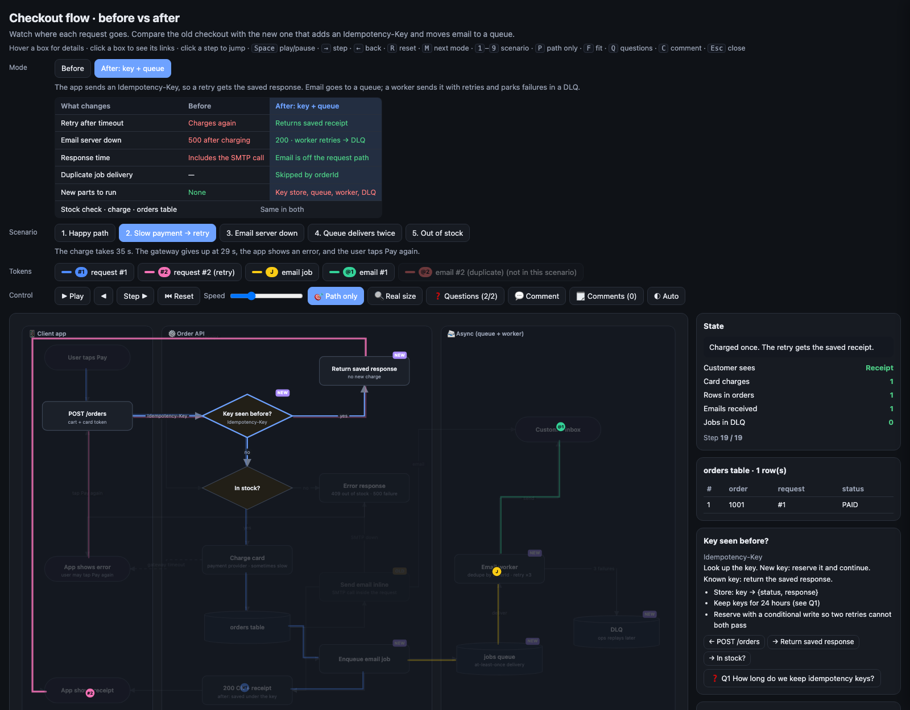

# Flow Motion

An interactive, animated flowchart in a single static page. Show how requests, messages and emails move through a system, step by step, and compare **before** and **after** a change across many **scenarios**.

No build, no dependencies, no network. Open `index.html` in a browser.



## Features

- **Flowchart:** lanes, boxes (rect, start/end, decision, database, task, note), arrows with labels and waypoints.
- **Motion:** coloured tokens move along the arrows. Play, pause, step, step back, speed, click any step to jump.
- **Modes:** show the same flow before and after a change. Boxes that exist only in one mode appear as a faint ghost in the others.
- **Diff table:** a short "what changes" table for the selected modes.
- **Scenarios:** each scenario has its own steps per mode, plus a one-line outcome.
- **State panel:** counters (green when right, red when too many), values, and table rows that fill in as the story plays.
- **Path only:** dims every box and arrow that the current scenario does not touch.
- **Click a box:** see its details, its neighbours, and related questions.
- **Questions drawer:** open questions with options, pros and cons, checkboxes and notes.
- **Comment mode:** click anywhere on the chart to pin a comment; export as JSON or Markdown, import JSON.
- **Deep links:** `#mode=after&scen=timeout&step=12&sel=node_id` opens that exact moment.
- **Built-in validation:** the page and `node tools/check.mjs` list every data error (missing edges, hidden nodes, token jumps, overlaps).
- **Layout audit:** the page lists every visual collision per mode (text overflow, lines through boxes, labels on lines, stacked lines).
- Light and dark themes, keyboard shortcuts, works offline from `file://`.

## Quick start

```sh
open index.html            # macOS   (or double-click it)
node tools/check.mjs       # check flow.js
```

The example in `flow.js` is an online checkout before and after adding an idempotency key and an email queue.

## Make your own flow

Everything about your flow is in `flow.js`. The engine (`index.html`) stays the same.

1. Copy this folder.
2. Replace the contents of `flow.js` (schema in [AGENTS.md](AGENTS.md)).
3. Run `node tools/check.mjs` until it prints `✔ OK`.
4. Open `index.html`.

### With an AI agent

Point your agent at this folder and ask, for example:

> Read `src/checkout/` and build a Flow Motion page in `flow.js` for the checkout flow. Two modes: current and proposed. Scenarios: happy path, payment timeout then retry, email server down. Run `node tools/check.mjs` until it passes.

`AGENTS.md` has the full schema, layout rules and checks. It is read automatically by agents that support `AGENTS.md`; `CLAUDE.md`, `GEMINI.md`, `.github/copilot-instructions.md`, `.cursor/rules/flow-motion.mdc` and `.kiro/steering/flow-motion.md` point to it for the others.

## Check before you share

```sh
node tools/check.mjs                    # data rules
node tools/audit.mjs . --shots shots    # data + layout (every mode) + self test (every scenario) + screenshots
```

Both exit 0 when clean. Then look at the screenshots: lines, labels and wording are easier to judge by eye.

## Claude Code

This repo ships a skill and a reviewer agent:

- `.claude/skills/flow-motion/` · how to build a page, the audit loop, and `LESSONS.md` (bugs met in real use and their fixes)
- `.claude/agents/flow-motion-auditor.md` · runs the scripts, opens every screenshot, checks claims against the source, reports only

They load automatically when Claude Code runs in this folder. To use them everywhere, copy them to `~/.claude/skills/flow-motion/` and `~/.claude/agents/`.

## Keyboard

| Key | Action |
|---|---|
| `Space` | play / pause |
| `→` / `←` | step forward / back |
| `R` | reset |
| `M` | next mode |
| `1`–`9` | scenario |
| `P` | path only |
| `F` | fit width / real size |
| `Q` | questions |
| `C` | comment mode |
| `Esc` | close / clear selection |

## Files

| File | What it is |
|---|---|
| `index.html` | Engine and UI |
| `flow.js` | Your data (`window.FLOW`) |
| `validate.js` | Data checks, shared by the page and the CLI |
| `tools/check.mjs` | `node tools/check.mjs [file]` · data rules, no browser |
| `tools/audit.mjs` | `node tools/audit.mjs [folder] [--shots dir] [--json]` · headless check + layout + self test |
| `.claude/` | Claude Code skill (`flow-motion`) and reviewer agent (`flow-motion-auditor`) |
| `AGENTS.md` | Guide for AI agents: schema, rules, verification |

Comments, answers and view settings are stored in the browser (`localStorage`) under `flowmotion:<FLOW.id>:`. Export comments to share them.

## License

MIT, see [LICENSE](LICENSE).
